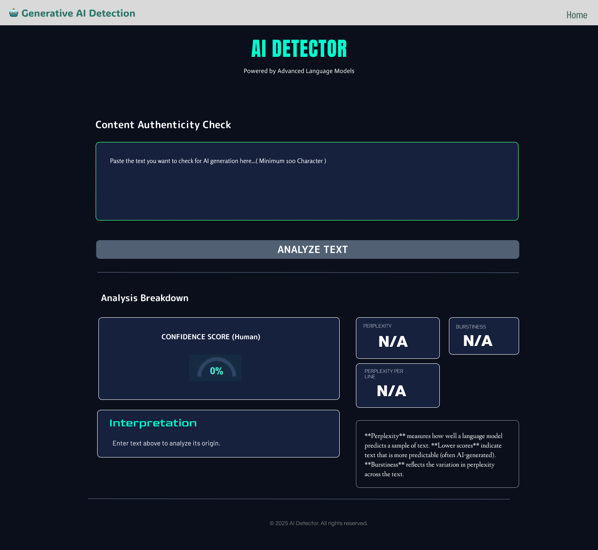
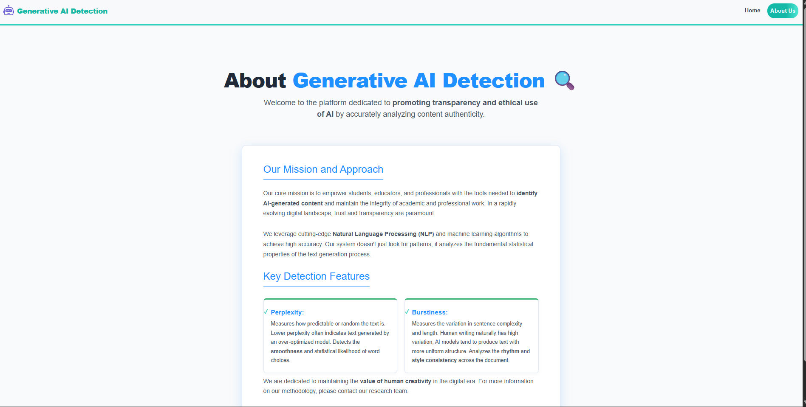
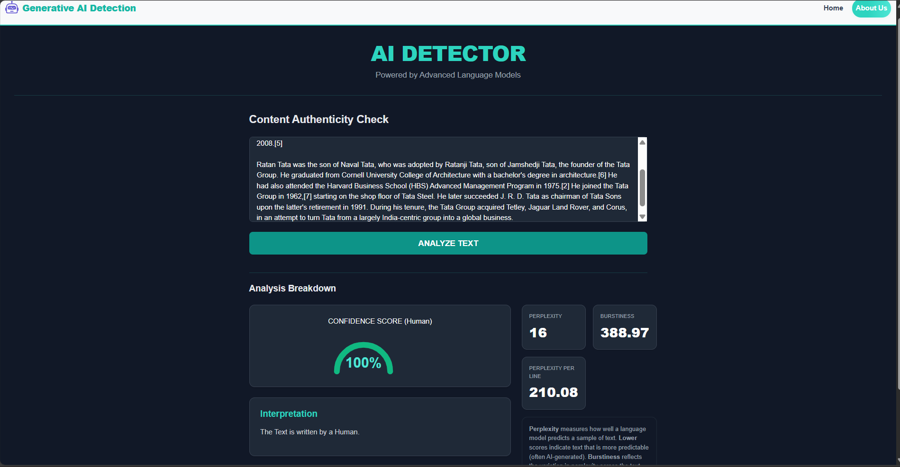
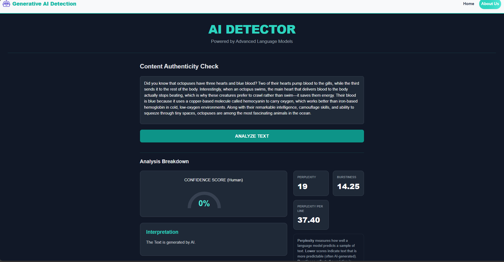

# 🤖 AI Content Detector

AI Content Detector is a full-stack web application that analyzes user-provided text and predicts whether it was written by a human or generated by AI. The app combines a React frontend with a Flask backend that uses a GPT-2 based perplexity approach to classify content.

---

## ✨ Features

- Detect whether text is AI-generated or human-written
- Show output with a clear result and confidence-oriented analysis
- Built with a responsive React user interface
- Flask backend powered by GPT-2 model inference
- Includes About section and landing page experience

---

## 🧠 Tech Stack

### Frontend
- React.js
- JavaScript / JSX
- Bootstrap / Tailwind-inspired styling
- Axios for API communication

### Backend
- Python
- Flask
- PyTorch
- Hugging Face Transformers
- NumPy

---

## 📁 Project Structure

```bash
Generative-AI-Detection/
├── .vscode/
├── public/
├── screenshots/
│   ├── AI-text-output.png
│   ├── HomePage.jpg
│   ├── Human-text-output.png
│   └── aboutUs.png
├── server/
│   └── app.py
├── src/
│   ├── Components/
│   ├── App.css
│   ├── App.js
│   ├── index.css
│   └── index.js
├── .gitignore
├── package.json
├── package-lock.json
├── README.md
└── ...
```

---

## 🚀 Getting Started

### 1. Clone the repository

```bash
git clone https://github.com/PatilAdhiraj/AI-Content-Detector.git Generative-AI-Detection
```

### 2. Navigate into the project directory

```bash
cd Generative-AI-Detection
```

### 3. Install frontend dependencies

```bash
npm install
```

### 4. Install backend dependencies

```bash
pip install flask flask-cors torch transformers numpy
```

### 5. Start the backend

From the project root:

```bash
cd server
python app.py
```

The first request triggers the GPT-2 model download (around 548 MB). Keep the backend terminal open while it downloads; later runs use the cached model.

### 6. Start the frontend

Open a second terminal in the project root and run:

```bash
npm start
```

Then open:

```bash
http://localhost:3000
```

---

## 🧪 How it works

The backend receives text through a POST request, loads the GPT-2 model on first use, and calculates perplexity-based metrics. The app then interprets those values to decide whether the content appears to be AI-generated or human-written.

---

## 📸 Screenshots

### Home Page


### About Us Page


### Human Content Detection


### AI Content Detection


---

## 🎨 Design Reference

Figma design:

```bash
https://www.figma.com/design/1IpFREB31q1n63wgCdjSez/Ai-content-detector?node-id=0-1&p=f&m=draw
```

---

## 📌 Notes

- The app requires Python and Node.js installed on your system.
- Internet access is needed for the first GPT-2 model download.
- If you want to contribute or improve the model logic, start from the Flask backend in `server/app.py` and the UI in `src/`.
